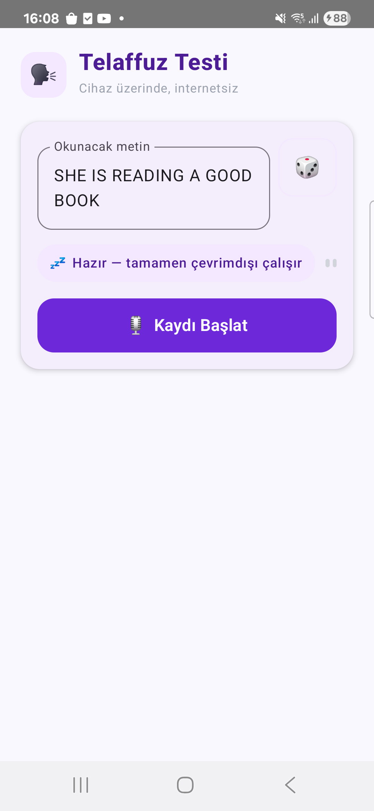

# 🗣️ Telaffuz Testi

İngilizce telaffuz pratiği için **tamamen cihaz üzerinde, internetsiz** çalışan bir Android uygulaması.
Bir metin okuyorsun, uygulama sesini kaydedip her fonem için ayrı ayrı bir güven skoru üretiyor —
"doğru mu yanlış mı" gibi kaba bir değerlendirme değil, hangi sesi tam olarak nasıl telaffuz ettiğinin
akustik seviyede analizi.



## Neden farklı

Çoğu telaffuz uygulaması, konuşmayı metne çevirip (STT) metni hedef cümleyle kıyaslıyor — bu da
"kelimeyi doğru mu söyledin" gibi kaba, foneme inmeyen bir sonuç veriyor. Bu uygulama onun yerine:

- Sesi doğrudan **fonem olasılıklarına** çeviren bir akustik modelin ham çıktısını kullanıyor,
- Bu çıktıyı hedef metnin beklenen fonem dizisiyle **zaman ekseninde hizalıyor** (forced alignment),
- Her fonem için modelin o sesi ne kadar net "duyduğunu" gösteren gerçek bir güven skoru üretiyor.

Ve bunların hepsi telefonun içinde oluyor — ses dosyası cihazdan hiç çıkmıyor, sunucuya gitmiyor.

## Nasıl çalışıyor

**1. Akustik model.** Fonem tanıma için önceden eğitilmiş, wav2vec2 mimarisine dayanan bir model
kullanılıyor: ham 16kHz ses dalgasını alıp her ~20ms'lik kare için 38 İngilizce fonem (ARPABET kod
sistemiyle) üzerinden bir olasılık dağılımı üretiyor. Model CTC (Connectionist Temporal
Classification) ile eğitilmiş — yani ses ile fonem arasındaki hizalamayı baştan bilmeden, kendi kendine
öğrenmiş bir yapı.

**2. Hedef fonem dizisi (g2p).** Okunacak İngilizce cümle, CMUdict sözlüğü (~130 bin kelimelik açık
telaffuz sözlüğü) üzerinden fonem dizisine çevriliyor — yani "bu cümlede hangi sesler bekleniyor"
listesi çıkarılıyor.

**3. CTC forced-alignment (sıfırdan yazıldı).** Modelin ham olasılık matrisi ile hedef fonem dizisi,
bir Viterbi dinamik programlama algoritmasıyla zaman ekseninde hizalanıyor — hangi fonemin, ses
dosyasının tam olarak hangi aralığında söylendiği bulunuyor. Bu algoritma önce Python/torchaudio ile
referans alınıp doğrulandı, sonra cihazda çalışması için **Kotlin'de sıfırdan yeniden yazıldı**
(`ForcedAligner.kt`).

**4. Güven skoru ve "duyulan ses" tespiti.** Her fonemin hizalandığı zaman aralığındaki ortalama
olasılık, 0-100 arası bir güven skoruna dönüştürülüyor. Kullanıcının aslında ne söylediğini göstermek
için, fonetik olarak yakın seslerden oluşan "karışma grupları" (confusion set) tanımlanmış — model bu
kısıtlı aday havuzunda en olası sesi seçiyor; bu sayede gürültüden anlamsız fonem uydurması engelleniyor.
Modelin düşük güvenli olduğu noktalar (cümle başı/sonu, tek karelik patlamalı sesler gibi bilinen kör
noktalar) kullanıcıya hatalıymış gibi gösterilmiyor.

**5. Cihaz üzerinde çalıştırma.** Model INT8'e quantize edilip ONNX formatına aktarıldı, Android'de
ONNX Runtime ile çalıştırılıyor. ~120MB'lık model dosyası bellek-eşlemeli (memory-mapped) olarak
yükleniyor — tamamını Java heap'e almaya çalışmak OOM'a sebep olduğu için.

```
ses (16kHz) → wav2vec2 (ONNX, INT8) → fonem olasılıkları
                                            │
hedef metin → CMUdict (g2p) → hedef fonem dizisi
                                            │
                                            ▼
                          CTC forced-alignment (Viterbi, Kotlin)
                                            │
                                            ▼
                        fonem başına güven skoru + "duyulan" tespiti
```

## Özellikler

- Fonem bazlı, renk kodlu telaffuz geri bildirimi (hedef vs. duyulan)
- Konuşurken canlı ses seviyesi animasyonu
- Her denemede rastgele pratik cümlesi
- Türkçe okunuşa yakın fonetik gösterim
- %100 çevrimdışı — internet izni bile yok

## Kurulum

Model boyutu (120MB+) nedeniyle repoya dahil edilmedi. Android projesini derlemeden önce:

```bash
cd backend
pip install -r requirements.txt
python export_onnx.py
cp onnx_model/model_int8.onnx ../android/app/src/main/assets/phoneme_model.onnx
```

Sonra `android/` klasörünü Android Studio ile açıp normal şekilde derleyip çalıştırabilirsiniz.

## Klasörler

- `android/` — Kotlin + Jetpack Compose Android uygulaması (tüm işleme cihaz üzerinde: ONNX Runtime + CMUdict + Kotlin'de yazılmış CTC forced-align)
- `backend/` — modeli ONNX'e çevirip doğrulamak için kullanılan Python script'leri (uygulamanın çalışması için gerekli değil, sadece geliştirme/model hazırlama aşamasında kullanılır)

## Kullanılan teknolojiler

Kotlin · Jetpack Compose · ONNX Runtime (Android) · wav2vec2 · CTC forced-alignment · CMUdict
